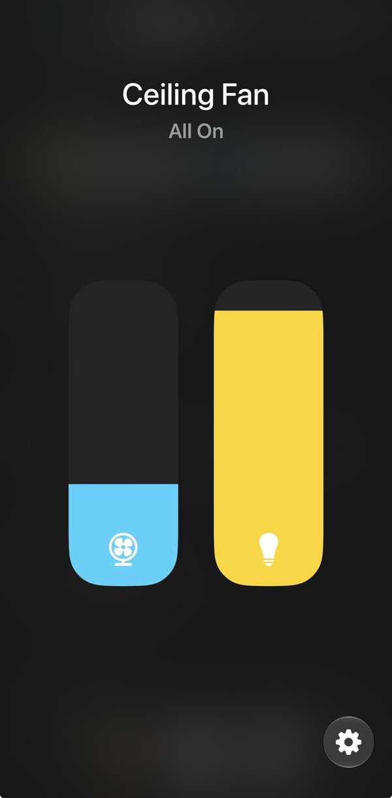

# Kitbash

A Home Assistant custom integration that assembles entities from any
integration into whole HomeKit accessories.

Home Assistant's own HomeKit bridge maps one entity to one accessory. Kitbash
lets you build a single accessory from several entities instead: a ceiling
fan's motor, light and direction switch become one fan tile. Each
accessory runs on Kitbash's own HAP-python driver and pairs with the Home app
on its own.

Entities can come from anywhere. A `number`, `input_number` or `select` can
stand in for a native fan speed, direction or mode, with a value mapping you
set in the form.

## What you can build

| Type | What it publishes |
|---|---|
| Fan | Fanv2: power, speed, Auto/Manual, oscillation and direction, with optional named-speed switches and a temperature reading |
| Ceiling fan | Fanv2 and a Lightbulb in one accessory |

<p align="center">
  
</p>

## Requirements

- Home Assistant 2026.9 or later.
- The Home Assistant host must be reachable from your iPhone or home hub on the
  local network. Each accessory listens on its own TCP port, starting at
  21200, and announces itself over mDNS.

## Install

**HACS:** add `https://github.com/frozenmartini/kitbash` as a custom repository
(Integration), install Kitbash, and restart Home Assistant.

**Manual:** copy `custom_components/kitbash/` into your Home Assistant
`config/custom_components/` folder and restart Home Assistant.

## Set up

1. Go to *Settings → Devices & services → Add integration → Kitbash*.
2. Choose the fan's device, then pick *Fan only* or *Ceiling fan*. Review the
   suggested parts, replace any of them with another entity if needed, and
   save.
3. A notification shows the HomeKit setup code. In the Home app choose *Add
   Accessory → More options…*, pick the accessory and enter the code.

### Changing an accessory

After **any** change to a Kitbash entry in Home Assistant (*Configure*, or deleting it and
adding it again), remove the accessory from the Home app and add it again as a new accessory,
with *Add Accessory → More options…* and its setup code. The old accessory shows
**No Response** in the Home app until you remove it.

## Limitations

- Kitbash creates no Home Assistant control entities. What you build is the
  accessory in the Home app, plus one diagnostic *Last HomeKit write* sensor
  per entry.
- Each entry is paired separately. Kitbash does not run a bridge.

## Troubleshooting

Kitbash can log everything that passes between the Home app and Home
Assistant. Each line records one of these:

- what the Home app read or changed, such as the fan turned on, the speed set
  to 60% or the light turned off;
- the Home Assistant service Kitbash called for it;
- the entity state changes Kitbash passed back to HomeKit.

Use it to see why an accessory does not do what you expect. To turn it on, add
this to `configuration.yaml` and restart Home Assistant:

```yaml
kitbash:
  dev_mode: true
```

A new log file is started at each Home Assistant start, under
`config/kitbash/logs/`. It changes nothing about how your accessories behave.

**Turn it off when you are done:** remove the lines and restart Home Assistant.
The log files are not rotated or size-limited, so they keep growing while it is
on. You can delete them afterwards.

## License

MIT
